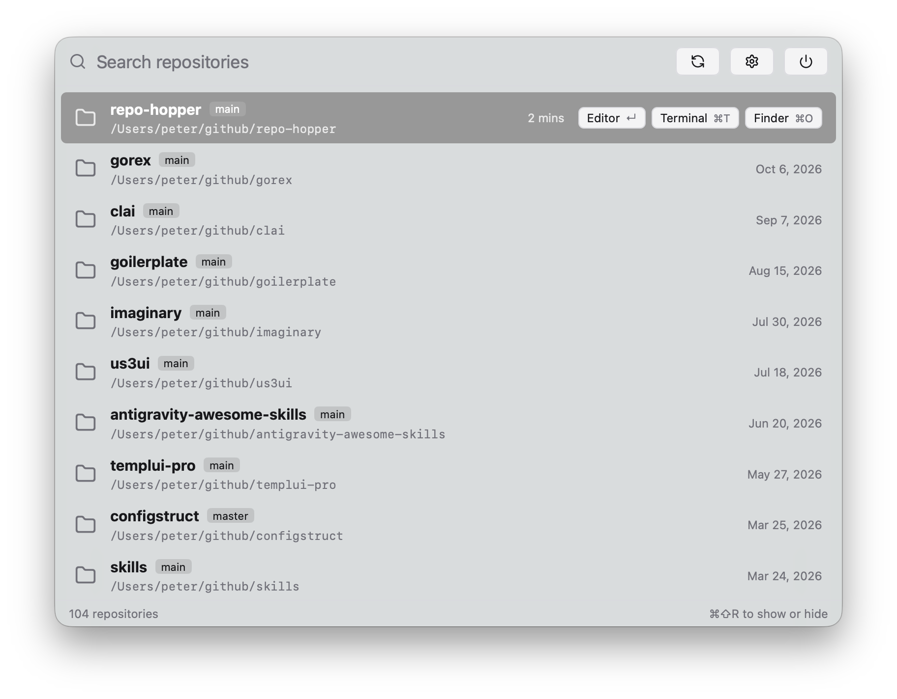

# 🐇 Repo Hopper

Are you juggling a dozen Git repositories at the same time? Do you constantly find yourself digging through Finder or typing long `cd` paths just to jump to the right project? **Repo Hopper** was built for that exact problem.

It's a fast, lightweight desktop launcher that keeps track of all your local Git repositories — and lets you jump to any of them in seconds. Think of it like Spotlight, but just for your repos.



---

## What it does

Repo Hopper scans your configured directories for Git repositories and presents them in a searchable list, sorted by the ones you touched most recently. From there, you can instantly open any repo in your editor, terminal, or Finder — with the keyboard, or with the buttons on each row.

**Key features:**
- 🔍 **Fuzzy search** — start typing a repo name or path and the list filters instantly
- ⏱️ **Recency-sorted** — the most recently changed repos float to the top
- ⌨️ **Keyboard-first** — navigate and open entirely without the mouse
- ⚡ **Always at hand** — a global shortcut summons it over any app, like Spotlight; it lives in the menu bar, not the Dock
- 🗂️ **Multi-directory scanning** — pick the folders to scan in Settings
- 🔄 **Auto-updates** — installed apps update themselves from GitHub releases
- 🪶 **Lightweight** — single binary, no Electron, no runtime, no nonsense

---

## Usage

Repo Hopper runs in the background: it has no Dock icon and no window until you call it.

- **Global shortcut:** press **`⌥⇧Space`** (Option+Shift+Space) in any app to show or hide the search panel. It opens on the screen with your mouse pointer, with an empty search. Change the shortcut in Settings.
- **Hiding:** the panel hides again when you open a repo, press `Esc` or click elsewhere. Repo Hopper keeps running, so the next time it appears instantly and the repo list is already scanned.
- **Menu-bar icon** (a folder 📁): Open Repo Hopper, Settings…, Check for Updates…, Open at Login, and Quit.
  > If you use a menu bar manager such as Bartender or Ice, the icon may be tucked away in its hidden section.
- **Mouse:** the chosen row, and the row under the pointer, show **Editor**, **Terminal** and **Finder** buttons. The toolbar has Re-scan, Settings and Quit (⏻).
- **Settings** (`⌘,`, the ⚙ button, or the menu-bar icon): add folders to scan with the system folder picker, remove them with ×, and edit the editor and terminal commands, the scan interval and depth, the excluded directory names (type a name and press Enter) and the global shortcut.
- **Quitting:** `⌘Q`, the ⏻ button, or Quit in the menu-bar icon's menu.

## Keyboard Shortcuts


| Key | Action |
|-----|--------|
| `↑` / `↓` | Navigate the repo list |
| `Enter` | Open selected repo in your configured editor |
| `⌘T` | Open selected repo in your terminal |
| `⌘O` | Open selected repo in Finder / file manager |
| `⌘E` | Open selected repo in your editor |
| `⌘R` | Re-scan |
| `⌘,` | Settings |
| `Esc` | Clear the search, or hide Repo Hopper |
| `⌘Q` | Quit |

---

## Configuration

Everything is editable in the Settings dialog. The settings are stored in `~/.config/repo-hopper/settings.json`, which you can also edit by hand:

```json
{
  "scan_dirs": [
    "/Users/yourname/github",
    "/Users/yourname/projects"
  ],
  "editor": "code",
  "terminal": "iTerm"
}
```

| Field | Description | Default |
|-------|-------------|---------|
| `scan_dirs` | List of root directories to scan for Git repos | your home directory |
| `editor` | CLI command for your editor (`code`, `goland`, `vim`, …) | `code` |
| `terminal` | Terminal app name (`Terminal`, `iTerm`, `Warp`, …) | `Terminal` |
| `rescan_interval_min` | Minutes between automatic re-scans | `5` |
| `max_depth` | How many directory levels deep to look for repos | `6` |
| `exclude_patterns` | Directory names to skip while scanning (exact names, not globs) | `node_modules`, `vendor`, `.cache`, `Library` |
| `global_shortcut` | Shows and hides Repo Hopper from any app, e.g. `Alt+Shift+Space`, `CmdOrCtrl+Shift+R` | `Alt+Shift+Space` |

---

## Installation

### Download

Grab the macOS disk image, Windows installer or Linux package from the [latest release](https://github.com/pteich/repo-hopper/releases/latest). Installed apps update themselves; builds you make yourself don't.

### Run directly (development)

> Only one Repo Hopper runs at a time: a second start just shows the running one's panel. Quit an installed copy (menu-bar icon → Quit) before `make dev` or `make run`, or you'll be looking at the old version.

```bash
make dev     # development app bundle, rebuilt as you edit
make run     # or plain `go run`
```

### Build a standalone binary

```bash
make build
./repo-hopper
```

### Build & install as a macOS .app

```bash
make install # builds RepoHopper.app and copies it to /Applications
```

> The `install` target also removes the macOS quarantine attribute and applies an ad-hoc code signature so the app runs without security prompts on your local machine.

---

## Platform support

Repo Hopper is written in Go and designed to be cross-platform — the GUI layer is built on [MyGo](https://github.com/egoist/mygo)'s native UI, which supports macOS, Linux, and Windows and needs no cgo, so every platform builds from any machine (`make build-all`).

**Currently only tested on macOS.** Linux and Windows support is intended and the underlying OS actions (open terminal, open file manager, open editor) already have platform-specific implementations — but these paths haven't been verified yet. Contributions welcome!

---

## Tech stack

- **Go** — single binary, fast startup, easy cross-compilation
- **[MyGo](https://github.com/egoist/mygo)** — native UI drawn on the GPU, pure Go (no cgo)
- **[fuzzy](https://github.com/sahilm/fuzzy)** — high-performance fuzzy matching for the search bar
- Concurrent directory scanning via `filepath.WalkDir` + goroutines

---

## License

MIT
